# Project Evo: App Flow

This document describes how people move through the app, what each page does, and how data moves between the browser, the API and the database. It follows `prd.md` (what to build) and `techstack.md` (what it is built with).

Diagrams use Mermaid and render in GitHub and most Markdown previews.

---

## 1. Route map

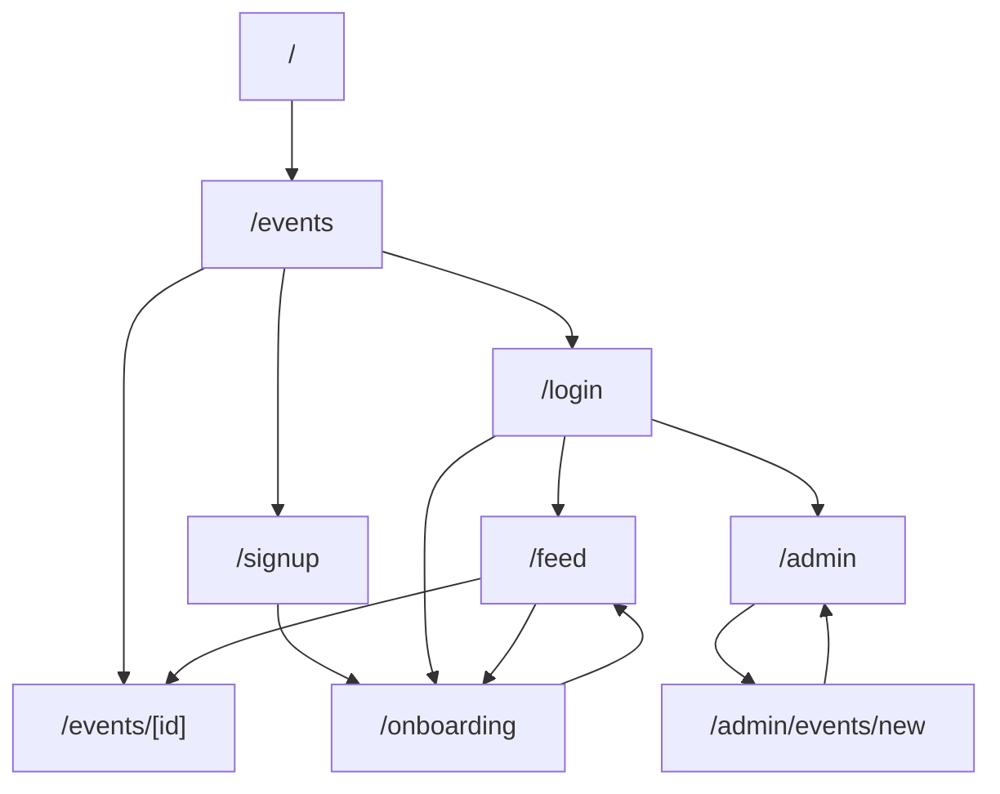

| Route | Access | Notes |
|---|---|---|
| `/` | Everyone | Redirects to `/events` |
| `/events` | Everyone | Filters and pagination, state kept in the URL |
| `/events/[id]` | Everyone | Remind me and card designer need login |
| `/signup`, `/login` | Logged-out | Logged-in users are redirected away |
| `/onboarding` | User | Pick favourite categories |
| `/feed` | User | My Feed |
| `/admin` | Admin | All events with Active toggle |
| `/admin/events/new` | Admin | Add event form |

---

## 2. Access control flow

Every request is checked on the server. The UI hides links too, but that is only for convenience.

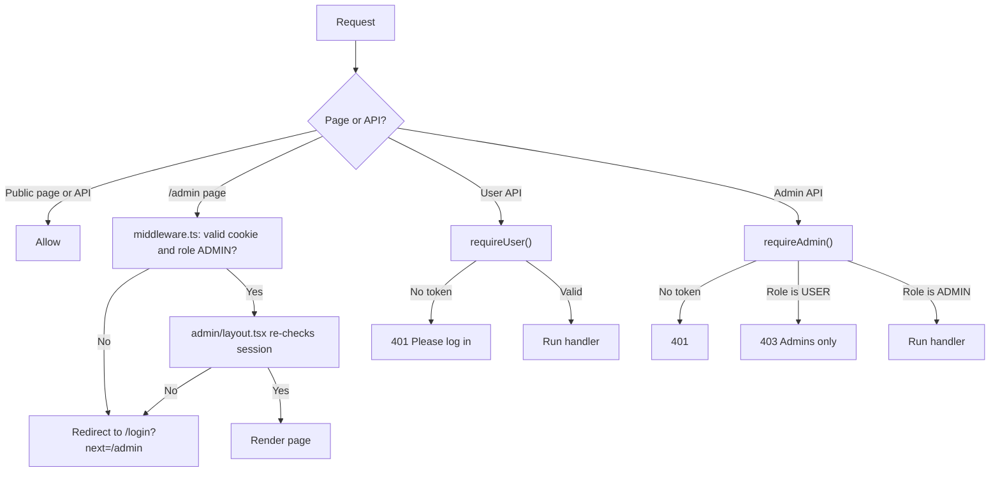

| Who | Public pages | `/feed`, `/onboarding` | `/admin/*` | `/api/admin/*` |
|---|---|---|---|---|
| Visitor | Allowed | Redirect to `/login` | Redirect to `/login` | 401 |
| User | Allowed | Allowed | Redirect to `/login` | 403 |
| Admin | Allowed | Allowed | Allowed | Allowed |

The token is read from `Authorization: Bearer <token>` first (mobile and API clients), then from the `httpOnly` cookie (web).

---

## 3. Authentication flows

### 3.1 Signup

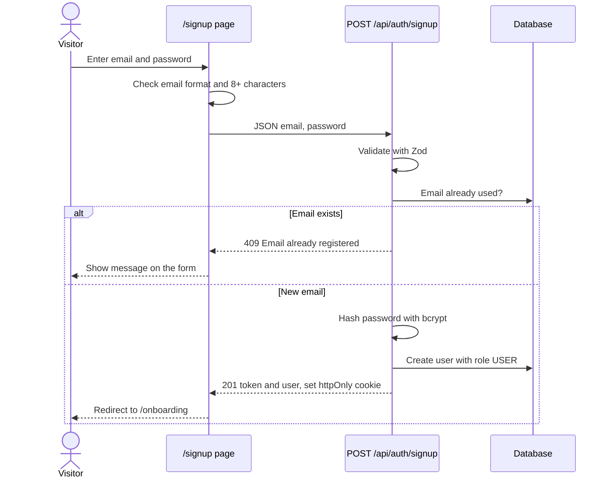

### 3.2 Login (users and admin)

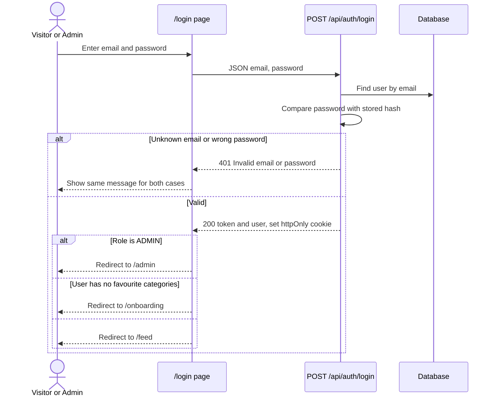

If the user arrived from a protected page, `?next=` sends them back there after login.

### 3.3 Session and logout
- A refresh keeps the user logged in because the cookie is sent with each request.
- **Log out** calls `POST /api/auth/logout`, which clears the cookie, then sends the user to `/events`.
- An expired or invalid token is treated as logged out. Protected pages redirect to `/login`.

---

## 4. Visitor and user journeys

### 4.1 Overall journey

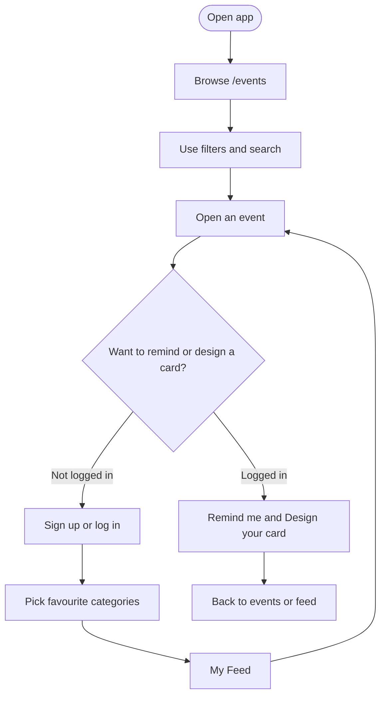

### 4.2 Events page (`/events`)

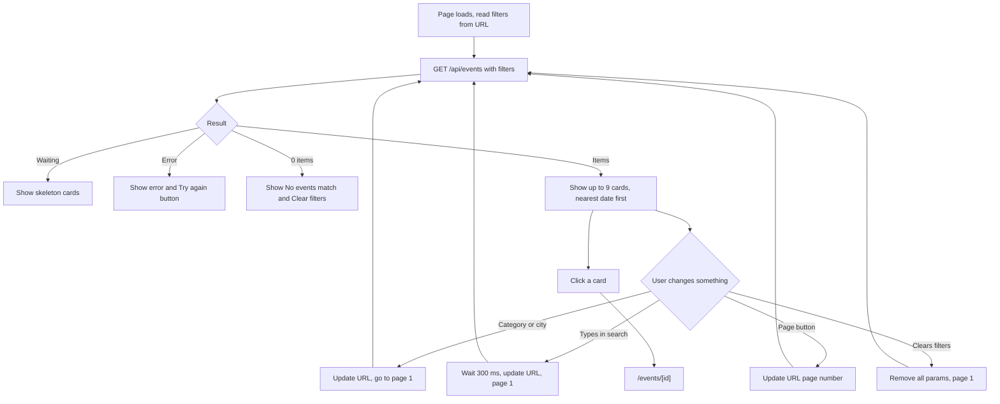

Rules:
- The server returns only events that are active and in the future, sorted by `startsAt` ascending.
- Category, city and search combine with AND.
- Filter state lives in the URL, so refresh, back button and sharing keep the same view.
- The city dropdown is filled from `GET /api/cities`.
- Prices show as ₹ with Indian grouping and 0 shows as "Free". Dates look like "Sat, 18 Oct, 6:30 PM".

### 4.3 Onboarding (`/onboarding`)

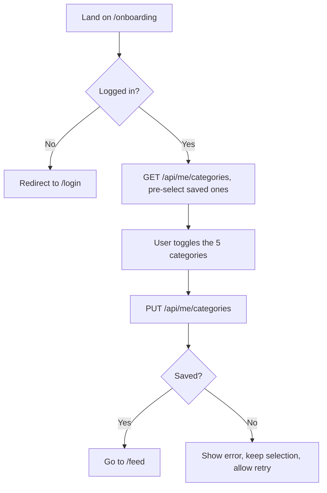

Saving replaces the previous selection. Saving with none selected is allowed.

### 4.4 My Feed (`/feed`)

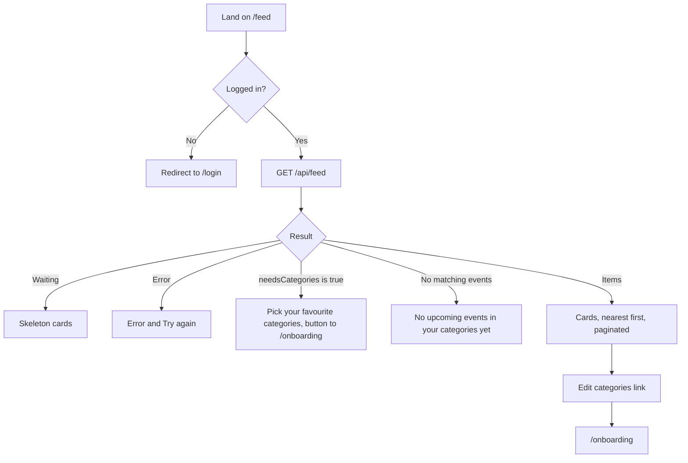

Only active, upcoming events from the user's favourite categories appear.

### 4.5 Event page (`/events/[id]`)

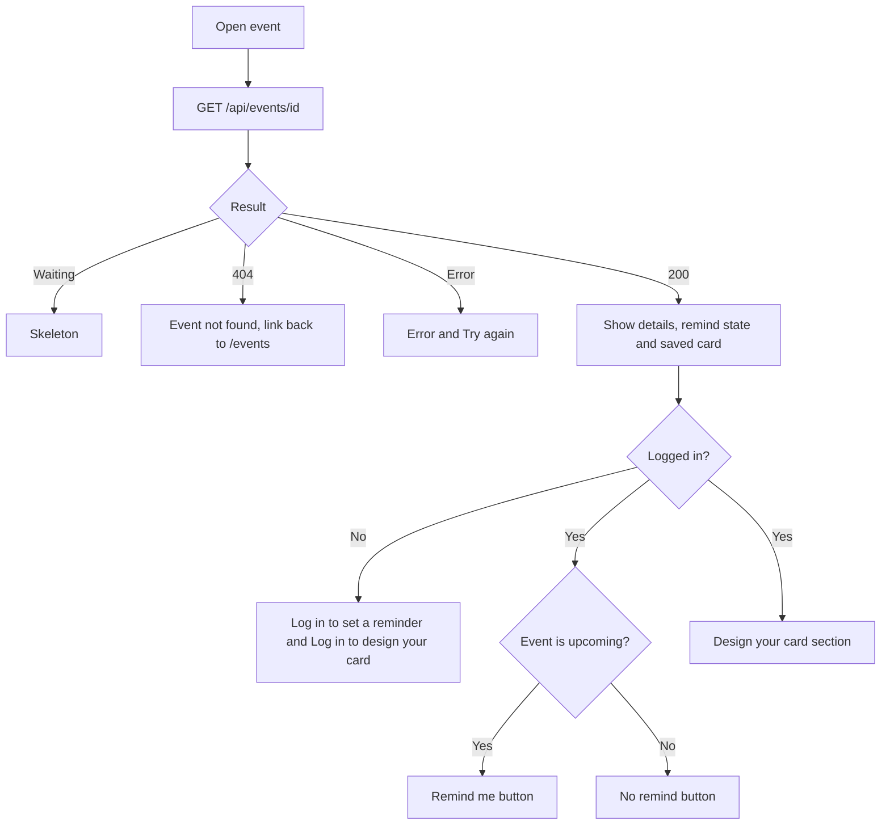

Inactive or unknown events return 404, so the page shows "Event not found".

---

## 5. Remind me flow (optimistic update)

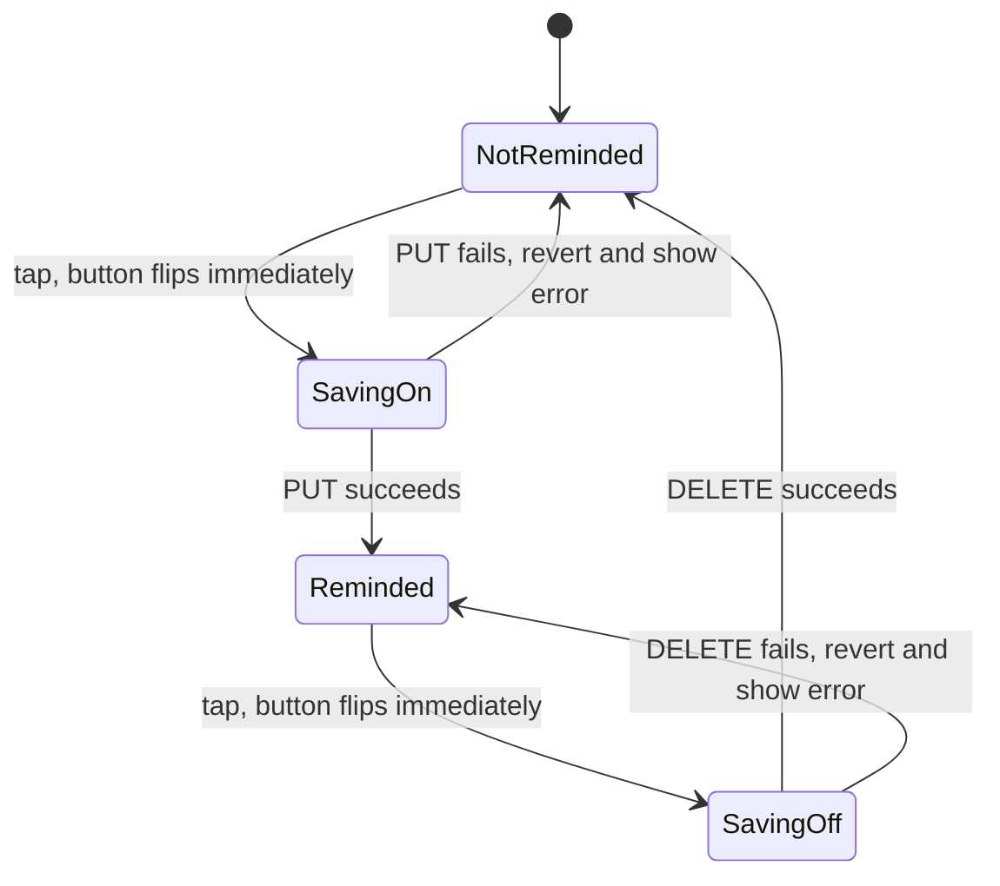

Details:
1. The initial state comes from `reminded` in the event response, so a refresh keeps it.
2. A tap changes the button immediately, then calls `PUT /api/events/:id/reminder` (or `DELETE` to remove).
3. While a request is in flight, extra taps are ignored.
4. On failure the button goes back to the previous state and shows "Couldn't save your reminder. Please try again."
5. The server uses an upsert, so repeated requests are safe.

---

## 6. Card designer flow

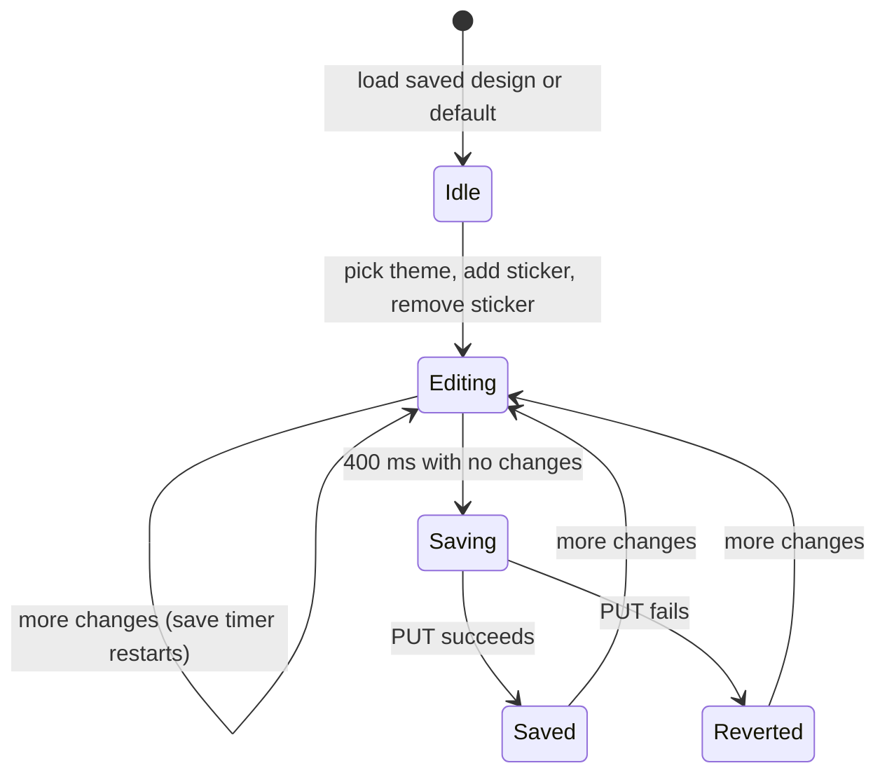

| Action | What happens |
|---|---|
| Pick a theme (Sunset, Ocean, Forest) | Card background animates to the new theme |
| Tap a sticker button | Sticker pops onto the card, counter updates (for example "2/3") |
| Tap at 3 stickers | Sticker buttons are disabled, and the server also rejects a fourth |
| Tap a sticker on the card | Sticker animates out and is removed |
| Stop changing for 400 ms | One `PUT /api/events/:id/card` saves theme and stickers together |
| Save fails | Card goes back to the last saved design and shows an error |
| Refresh | The saved design loads from the API |

The design is stored per user per event. Default design: Sunset theme, no stickers.

---

## 7. Admin flows

### 7.1 Admin home (`/admin`)

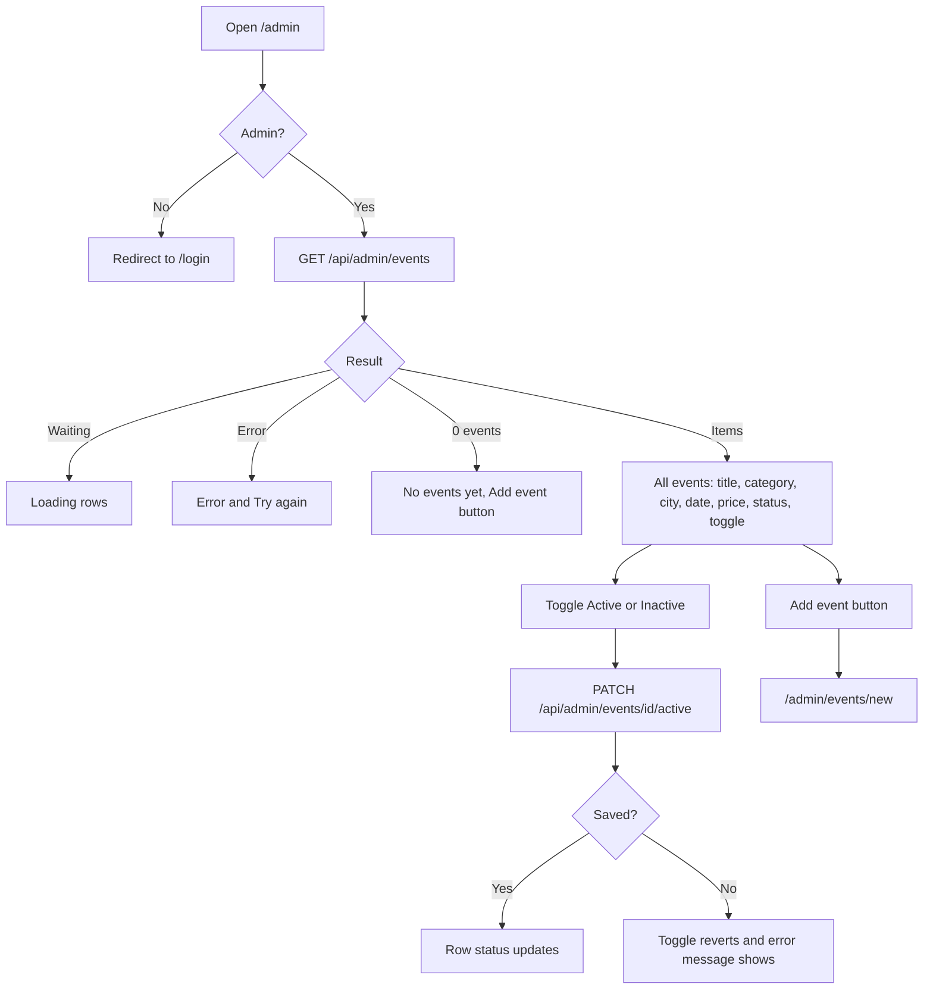

The admin list shows every event, including inactive and past ones. There is no delete.

### 7.2 Add event (`/admin/events/new`)

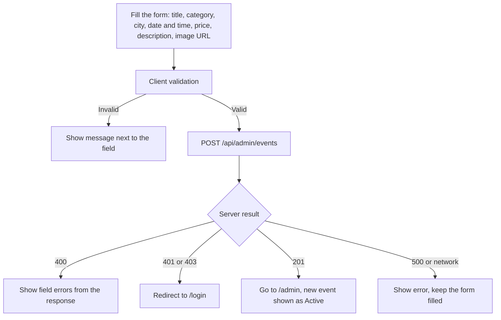

The server validates the same rules, so the form can never be bypassed.

---

## 8. Data flow for filtering

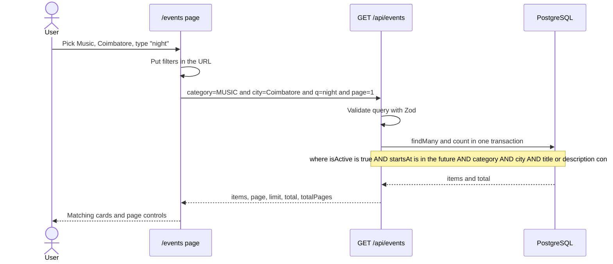

The main index is `Event(isActive, startsAt)`, which matches the base filter and sort. A `Event(category, city)` index supports the category and city filters.

---

## 9. Error and empty state map

| Place | Loading | Empty | Error |
|---|---|---|---|
| `/events` | Skeleton cards | "No events match your filters" and Clear filters | Message and Try again |
| `/feed` | Skeleton cards | Pick categories prompt, or "No upcoming events in your categories yet" | Message and Try again |
| `/events/[id]` | Skeleton | "Event not found" page | Message and Try again |
| Remind me | Button flips instantly | Not applicable | Button reverts and shows a message |
| Card designer | "Saving..." | Default design (Sunset, no stickers) | Reverts to last saved and shows a message |
| `/admin` | Loading rows | "No events yet" and Add event | Message and Try again |
| Forms | Disabled submit with spinner | Not applicable | Field messages from the server |

---

## 10. API status codes by flow

| Situation | Status | Body |
|---|---|---|
| Invalid input (bad email, 4th sticker, short title) | 400 | `{ "error": "Invalid input", "details": { ... } }` |
| No token on a protected route | 401 | `{ "error": "Please log in" }` |
| Wrong email or password | 401 | `{ "error": "Invalid email or password" }` |
| User calls an admin route | 403 | `{ "error": "Admins only" }` |
| Event not found, inactive, or unknown id | 404 | `{ "error": "Event not found" }` |
| Email already registered | 409 | `{ "error": "Email already registered" }` |
| Reminder on a past event | 409 | `{ "error": "Event has already started" }` |
| Unexpected server error | 500 | `{ "error": "Something went wrong" }` |

---

## 11. Screen-by-screen checklist

| Screen | Must show |
|---|---|
| Header | Product name, Events, My Feed (logged in), Admin (admin only), Login and Sign up or Log out |
| Event card | Image, title, category, city, friendly date, Indian-format price |
| Filters bar | Category select, city select, search box, Clear filters |
| Pagination | Previous, next, "Page X of Y" |
| Event page | Full details, Remind me, Design your card |
| Admin table | Title, category, city, date, price, status, toggle |

---

## 12. Known gap to fix in code

`prd.md` says reminders are only allowed on upcoming events, and the flows above use a 409 for that case. The reminder `PUT` handler written earlier does not check this yet. Add a check that returns 409 when `startsAt` is in the past, and add `GET /api/cities` for the city filter.
