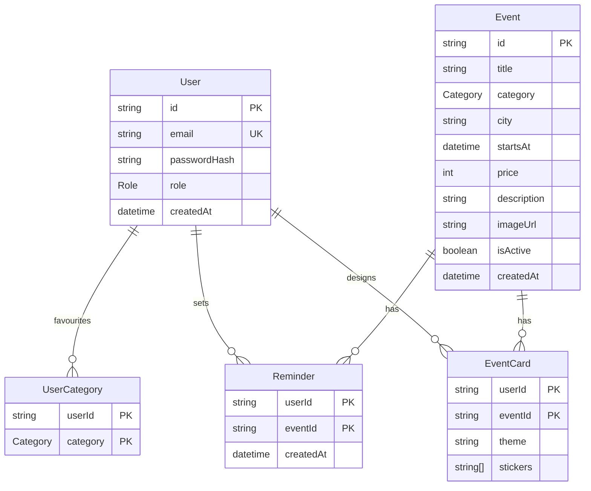

# Project Evo: Backend Schema

This document defines the database structure, the rules that keep data correct, and the exact contract of every API endpoint. It follows `prd.md` (what to build), `techstack.md` (technology) and `app-flow.md` (user flows).

---

## 1. Overview

| Item | Choice |
|---|---|
| Database | PostgreSQL 16 |
| ORM | Prisma |
| API | Next.js Route Handlers under `src/app/api` |
| Validation | Zod on every input |
| Auth | JWT (HS256, 7 days) and bcrypt (cost 12) |

---

## 2. Entity relationship diagram



---

## 3. Enums

| Enum | Values |
|---|---|
| `Role` | `USER`, `ADMIN` |
| `Category` | `MUSIC`, `WORKSHOP`, `FOOD`, `SPORTS`, `KIDS` |

Display names (Music, Workshop, and so on) are produced in the UI. The database stores the uppercase enum value.

---

## 4. Tables

### 4.1 `User`

| Column | Type | Constraints | Notes |
|---|---|---|---|
| `id` | text | PK, default `cuid()` | |
| `email` | text | UNIQUE, NOT NULL | Stored lowercase. The API lowercases before every lookup and insert. |
| `passwordHash` | text | NOT NULL | bcrypt hash, never the plain password |
| `role` | `Role` | NOT NULL, default `USER` | The single admin is seeded as `ADMIN` |
| `createdAt` | timestamptz | NOT NULL, default `now()` | |

### 4.2 `Event`

| Column | Type | Constraints | Notes |
|---|---|---|---|
| `id` | text | PK, default `cuid()` | |
| `title` | text | NOT NULL | 3 to 120 characters (API rule) |
| `category` | `Category` | NOT NULL | |
| `city` | text | NOT NULL | 2 to 60 characters, trimmed |
| `startsAt` | timestamptz | NOT NULL | Stored in UTC, shown in `Asia/Kolkata` |
| `price` | integer | NOT NULL | Whole rupees. `0` means free. |
| `description` | text | NOT NULL | 10 to 2000 characters (API rule) |
| `imageUrl` | text | NOT NULL | Valid URL (API rule) |
| `isActive` | boolean | NOT NULL, default `true` | Events are never deleted, only deactivated |
| `createdAt` | timestamptz | NOT NULL, default `now()` | |

### 4.3 `UserCategory` (favourite categories)

| Column | Type | Constraints |
|---|---|---|
| `userId` | text | FK to `User.id`, ON DELETE CASCADE |
| `category` | `Category` | |
| | | PK `(userId, category)` |

One row per favourite. The composite key makes duplicates impossible.

### 4.4 `Reminder`

| Column | Type | Constraints |
|---|---|---|
| `userId` | text | FK to `User.id`, ON DELETE CASCADE |
| `eventId` | text | FK to `Event.id`, ON DELETE CASCADE |
| `createdAt` | timestamptz | NOT NULL, default `now()` |
| | | PK `(userId, eventId)` |

A row means "this user wants a reminder for this event". No row means no reminder.

### 4.5 `EventCard`

| Column | Type | Constraints | Notes |
|---|---|---|---|
| `userId` | text | FK to `User.id`, ON DELETE CASCADE | |
| `eventId` | text | FK to `Event.id`, ON DELETE CASCADE | |
| `theme` | text | NOT NULL | One of `sunset`, `ocean`, `forest` (API allow-list) |
| `stickers` | text[] | NOT NULL | At most 3 items, each from the sticker allow-list (API rule) |
| | | | PK `(userId, eventId)` |

One design per user per event. Saving uses an upsert.

---

## 5. Why the schema looks like this

| Decision | Reason |
|---|---|
| Join table for favourite categories | The feed query becomes a plain `category IN (...)`, and each pick is a row that cannot be duplicated. |
| Composite primary keys on `Reminder`, `UserCategory`, `EventCard` | No separate id needed. Duplicates are impossible. Saves are safe to repeat (idempotent upserts). |
| `isActive` flag, no delete | The brief says never delete. Reminders and cards stay valid, and the admin can bring an event back. |
| `price` as integer rupees | Avoids floating-point money bugs. Formatting happens at display time only. |
| `startsAt` in UTC | No timezone ambiguity in queries. "Upcoming" is `startsAt >= now()`. |
| `EventCard.stickers` as `text[]` | Small ordered list owned by one row. A separate table would add joins for no benefit. |
| Enums for category and role | The database rejects invalid values, and the same list is reused in the API validation. |
| `ON DELETE CASCADE` on child tables | Removing a user or event cleans up its reminders and cards. |

---

## 6. Indexes

| Index | Columns | Used by |
|---|---|---|
| Primary and unique keys | `User.id`, `User.email`, `Event.id`, composite keys | Lookups, login, upserts |
| `Event_isActive_startsAt_idx` | `(isActive, startsAt)` | Events list and feed: active, upcoming, sorted by date |
| `Event_category_city_idx` | `(category, city)` | Category and city filters |

**Planned upgrade for text search.** The current search uses case-insensitive `contains` (`ILIKE '%text%'`), which cannot use a normal B-tree index. If the table grows, add a trigram index through a raw SQL migration:

```sql
CREATE EXTENSION IF NOT EXISTS pg_trgm;
CREATE INDEX event_title_trgm_idx ON "Event" USING GIN (title gin_trgm_ops);
```

---

## 7. Prisma schema (source of truth)

```prisma
generator client {
  provider = "prisma-client-js"
}

datasource db {
  provider = "postgresql"
  url      = env("DATABASE_URL")
}

enum Role {
  USER
  ADMIN
}

enum Category {
  MUSIC
  WORKSHOP
  FOOD
  SPORTS
  KIDS
}

model User {
  id           String         @id @default(cuid())
  email        String         @unique
  passwordHash String
  role         Role           @default(USER)
  createdAt    DateTime       @default(now())
  categories   UserCategory[]
  reminders    Reminder[]
  cards        EventCard[]
}

model Event {
  id          String      @id @default(cuid())
  title       String
  category    Category
  city        String
  startsAt    DateTime
  price       Int
  description String
  imageUrl    String
  isActive    Boolean     @default(true)
  createdAt   DateTime    @default(now())
  reminders   Reminder[]
  cards       EventCard[]

  @@index([isActive, startsAt])
  @@index([category, city])
}

model UserCategory {
  userId   String
  category Category
  user     User     @relation(fields: [userId], references: [id], onDelete: Cascade)

  @@id([userId, category])
}

model Reminder {
  userId    String
  eventId   String
  createdAt DateTime @default(now())
  user      User     @relation(fields: [userId], references: [id], onDelete: Cascade)
  event     Event    @relation(fields: [eventId], references: [id], onDelete: Cascade)

  @@id([userId, eventId])
}

model EventCard {
  userId   String
  eventId  String
  theme    String
  stickers String[]
  user     User     @relation(fields: [userId], references: [id], onDelete: Cascade)
  event    Event    @relation(fields: [eventId], references: [id], onDelete: Cascade)

  @@id([userId, eventId])
}
```

---

## 8. Core queries

All "visible event" queries share this base condition:

```ts
const visible = { isActive: true, startsAt: { gte: new Date() } };
```

| Purpose | Query |
|---|---|
| Events list | `where: { ...visible, category?, city? (case-insensitive equals), OR: [title contains q, description contains q] }`, `orderBy: { startsAt: "asc" }`, `skip`, `take` |
| Total for pagination | `count` with the same `where`, run in one `$transaction` with the list query |
| Feed | Read the user's `UserCategory` rows, then `where: { ...visible, category: { in: categories } }` with the same order and paging |
| Cities for the filter | `findMany({ where: visible, distinct: ["city"], select: { city: true }, orderBy: { city: "asc" } })` |
| Event detail | `findFirst({ where: { id, isActive: true } })`, plus the user's `Reminder` and `EventCard` rows if logged in |
| Set reminder | Check event is active and upcoming, then `upsert` on `(userId, eventId)` |
| Clear reminder | `deleteMany({ where: { userId, eventId } })` (safe even if it does not exist) |
| Save card | Check event is active, then `upsert` on `(userId, eventId)` |
| Replace favourites | `$transaction([deleteMany for user, createMany for new list])` |
| Admin list | `findMany({ orderBy: { startsAt: "desc" } })` with no filters |
| Toggle active | `updateMany({ where: { id }, data: { isActive } })`, and 404 if the count is 0 |

---

## 9. Shared validation rules

| Field | Rule |
|---|---|
| `email` | Valid email, lowercased |
| `password` (signup) | At least 8 characters |
| `title` | Trimmed, 3 to 120 characters |
| `category` | One of the 5 enum values |
| `city` | Trimmed, 2 to 60 characters |
| `startsAt` | Valid date |
| `price` | Integer, 0 to 10,000,000 |
| `description` | Trimmed, 10 to 2000 characters |
| `imageUrl` | Valid URL |
| `page` | Integer, at least 1, default 1 |
| `limit` | Integer, 1 to 50, default 9 |
| `theme` | `sunset`, `ocean` or `forest` |
| `stickers` | Array of at most 3 items, each one of 🎵 🍕 🎉 ⭐ 🔥 |
| `categories` (favourites) | Array of enum values, at most 5, duplicates removed |

---

## 10. Authentication contract

**JWT payload**

```json
{ "sub": "<userId>", "role": "USER", "iat": 1760000000, "exp": 1760604800 }
```

- Algorithm HS256, signed with `JWT_SECRET`, 7-day expiry.
- Sent as `Authorization: Bearer <token>` (mobile and API clients), or read from the `httpOnly` `token` cookie (web).
- Cookie settings: `httpOnly`, `sameSite=lax`, `secure` in production, `path=/`, 7-day max age.

**Guards**

| Guard | Passes when | Failure |
|---|---|---|
| `getSession()` | Returns the session or `null`, never throws | None |
| `requireUser()` | Valid token | 401 `Please log in` |
| `requireAdmin()` | Valid token and `role = ADMIN` | 401, or 403 `Admins only` |

---

## 11. API contract

### Common response shapes

**Error**

```json
{ "error": "Invalid input", "details": { "title": ["String must contain at least 3 character(s)"] } }
```

`details` appears only for validation errors (400).

**Event object**

```json
{
  "id": "cm1abc...",
  "title": "Unplugged Music Night",
  "category": "MUSIC",
  "city": "Coimbatore",
  "startsAt": "2026-10-13T13:00:00.000Z",
  "price": 499,
  "description": "An acoustic evening with local bands and open mic slots.",
  "imageUrl": "https://picsum.photos/seed/event-1/800/500",
  "isActive": true,
  "createdAt": "2026-10-10T08:00:00.000Z"
}
```

**Paginated list**

```json
{ "items": [ /* Event objects */ ], "page": 1, "limit": 9, "total": 23, "totalPages": 3 }
```

---

### 11.1 Auth

#### `POST /api/auth/signup`
Request: `{ "email": "a@b.com", "password": "min8chars" }`

| Status | Body |
|---|---|
| 201 | `{ "token": "...", "user": { "id", "email", "role": "USER" } }` and sets the cookie |
| 400 | Validation error |
| 409 | `{ "error": "Email already registered" }` |

#### `POST /api/auth/login`
Request: `{ "email": "a@b.com", "password": "..." }`

| Status | Body |
|---|---|
| 200 | `{ "token": "...", "user": { "id", "email", "role" } }` and sets the cookie |
| 400 | Validation error |
| 401 | `{ "error": "Invalid email or password" }` (same for unknown email and wrong password) |

#### `POST /api/auth/logout`
No body. Returns 200 `{ "ok": true }` and clears the cookie.

---

### 11.2 Public events

#### `GET /api/events`
Query: `category` (optional enum), `city` (optional), `q` (optional), `page` (default 1), `limit` (default 9, max 50).

Returns active, upcoming events, nearest first, as a paginated list. All provided filters combine with AND.

| Status | Body |
|---|---|
| 200 | Paginated list |
| 400 | Validation error (for example `category=FOO`) |

#### `GET /api/cities`
Returns the cities that have active, upcoming events.

```json
{ "cities": ["Bengaluru", "Chennai", "Coimbatore", "Mumbai"] }
```

#### `GET /api/events/:id`
Auth optional. Active events only (past ones are viewable, but see the reminder rule below).

```json
{
  "event": { /* Event object */ },
  "reminded": false,
  "card": null
}
```

When logged in, `reminded` is the user's real value and `card` is `{ "theme": "ocean", "stickers": ["🎵", "🔥"] }` if a design is saved, otherwise `null`. Logged-out callers always get `reminded: false` and `card: null`.

| Status | Body |
|---|---|
| 200 | As above |
| 404 | `{ "error": "Event not found" }` (unknown or inactive) |

---

### 11.3 User features (login required)

#### `GET /api/me/categories`
200: `{ "categories": ["MUSIC", "FOOD"] }`

#### `PUT /api/me/categories`
Request: `{ "categories": ["MUSIC", "FOOD"] }`. Replaces the full set (an empty array is allowed).
200: `{ "categories": ["MUSIC", "FOOD"] }`

#### `GET /api/feed`
Query: `page`, `limit`. Active, upcoming events from the user's favourite categories, nearest first.

```json
{ "items": [], "page": 1, "limit": 9, "total": 0, "totalPages": 0, "needsCategories": true }
```

`needsCategories` is `true` only when the user has no favourites yet, so the UI can show the right empty state.

#### `PUT /api/events/:id/reminder`
Sets the reminder (idempotent). 200: `{ "reminded": true }`

| Status | When |
|---|---|
| 401 | Not logged in |
| 404 | Event not found or inactive |
| 409 | Event has already started: `{ "error": "Event has already started" }` |

#### `DELETE /api/events/:id/reminder`
Clears the reminder (idempotent). 200: `{ "reminded": false }`

#### `GET /api/events/:id/card`
200: `{ "theme": "sunset", "stickers": [] }` (the default when nothing is saved)

#### `PUT /api/events/:id/card`
Request: `{ "theme": "ocean", "stickers": ["🎵", "🔥"] }`
200: `{ "theme": "ocean", "stickers": ["🎵", "🔥"] }`

| Status | When |
|---|---|
| 400 | Invalid theme, unknown sticker, or more than 3 stickers |
| 401 | Not logged in |
| 404 | Event not found or inactive |

---

### 11.4 Admin (admin required)

#### `GET /api/admin/events`
200: `{ "items": [ /* all Event objects, newest start date first, including inactive and past */ ] }`

#### `POST /api/admin/events`
Request:

```json
{
  "title": "Pottery for Beginners",
  "category": "WORKSHOP",
  "city": "Bengaluru",
  "startsAt": "2026-10-25T04:30:00.000Z",
  "price": 1200,
  "description": "Hands-on wheel throwing. Clay and apron provided.",
  "imageUrl": "https://example.com/pottery.jpg"
}
```

| Status | Body |
|---|---|
| 201 | The created Event object (active by default) |
| 400 | Validation error |
| 401, 403 | Not logged in, or not an admin |

#### `PATCH /api/admin/events/:id/active`
Request: `{ "isActive": false }`

| Status | Body |
|---|---|
| 200 | `{ "id": "...", "isActive": false }` |
| 400 | Validation error |
| 401, 403 | Not logged in, or not an admin |
| 404 | `{ "error": "Event not found" }` |

---

## 12. Endpoint summary

| Method | Path | Auth |
|---|---|---|
| POST | `/api/auth/signup` | none |
| POST | `/api/auth/login` | none |
| POST | `/api/auth/logout` | none |
| GET | `/api/events` | none |
| GET | `/api/cities` | none |
| GET | `/api/events/:id` | optional |
| GET, PUT | `/api/me/categories` | user |
| GET | `/api/feed` | user |
| PUT, DELETE | `/api/events/:id/reminder` | user |
| GET, PUT | `/api/events/:id/card` | user |
| GET, POST | `/api/admin/events` | admin |
| PATCH | `/api/admin/events/:id/active` | admin |

---

## 13. Seed data specification

| Item | Value |
|---|---|
| Admin | `admin@events.test` / `Admin@123`, role `ADMIN`, created with `upsert` so re-running never duplicates it |
| Events | 15 total, regenerated on each run (`deleteMany` then `createMany`) |
| Active and upcoming | 9, spread across all 5 categories and the cities Coimbatore, Bengaluru, Chennai, Mumbai |
| Inactive | 3, with future dates |
| Past | 3, active but with dates in the past |
| Prices | At least one free event and one above ₹1,000 |
| Dates | Calculated relative to the current time, so the split stays correct whenever the project is run |

Reseeding deletes events, and because of the cascade rules it also deletes reminders and card designs for those events. That is fine for sample data, but never run the seed against a database with real data.

---

## 14. Integrity rules

1. Emails are unique and stored lowercase.
2. A user has at most one reminder and one card design per event (composite keys).
3. A user has at most one row per favourite category (composite key).
4. A card never has more than 3 stickers or an unknown theme, enforced by the API.
5. Deleting a user or event removes its dependent rows (cascade).
6. Events are never deleted by the app. Visibility is controlled only by `isActive` and `startsAt`.
7. Every write to admin data goes through `requireAdmin()`, and every user-owned row is scoped by the `userId` from the token, never from the request body.

---

## 15. Changes needed in code

These two items come from `prd.md` and are not in the code written so far:

1. **Add `GET /api/cities`** using the query in section 8.
2. **Reject reminders on past events** in the `PUT /api/events/:id/reminder` handler:

```ts
const event = await db.event.findFirst({ where: { id: eventId, isActive: true } });
if (!event) return NextResponse.json({ error: "Event not found" }, { status: 404 });
if (event.startsAt < new Date()) {
  return NextResponse.json({ error: "Event has already started" }, { status: 409 });
}
```
